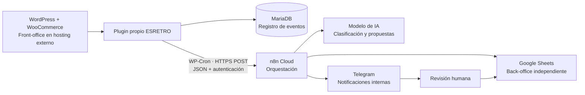

# ESRETRO | Tarea 2: Integración, automatización e IA aplicada al back-office

**Asignatura:** Soluciones Informáticas para la Empresa · Grado en Ingeniería Informática (UCAM)  
**Equipo:** Américo Macías Silvestre, Javier Martín Rodríguez y Miguel Del Rivero Usón  
**Proyecto:** prototipo académico de comercio electrónico de consolas y videojuegos retro. **No realiza ventas ni cobros reales.**

> Este documento complementa el [README principal](README.md), dedicado principalmente a la Tarea 1. Explica la arquitectura, la puesta en marcha, el uso y la validación de la Tarea 2.

## 1. Objetivo y alcance

La Tarea 2 conecta el canal de venta **WordPress + WooCommerce** de ESRETRO con un **back-office independiente**, desplegado fuera del entorno local. Para ello se utiliza **n8n Cloud** como plataforma de integración y orquestación de procesos, **Google Sheets** como back-office académico y servicios de **IA** y **Telegram** para apoyar la gestión postventa.

Los tres escenarios son:

1. **Nuevo pedido:** `order.created` registra o actualiza la información del pedido en el back-office.
2. **Cambio de estado:** `order.status_changed` sincroniza el estado de un pedido existente.
3. **Incidencia postventa:** `support.requested` crea la incidencia, obtiene una clasificación y propuesta de respuesta mediante IA y facilita la supervisión humana.

La integración aplica validación de contratos JSON, comprobación de identificadores, prevención de duplicados (*idempotencia básica*), registro de resultados y tratamiento de errores.

## 2. Arquitectura y despliegue



| Componente | Función | Entorno |
| --- | --- | --- |
| WordPress + WooCommerce | Tienda, pedidos, estados y formulario de soporte | DonDominio, público |
| Plugin ESRETRO (PHP) | Registro de eventos, contrato JSON y envío HTTP | Instalación WordPress |
| MariaDB | Persistencia de los eventos de origen | Base de datos de WordPress |
| n8n Cloud | Recepción, validación, enrutamiento y automatización | Servicio cloud independiente |
| Google Sheets | Pedidos, incidencias, integraciones, pruebas y métricas | Servicio cloud independiente |
| IA | Clasificación, prioridad y propuesta de respuesta | Servicio externo conectado a n8n |
| Telegram | Avisos internos y revisión de propuestas | Bot y grupo del equipo |

**Accesos de referencia:**

- Tienda: https://www.esretro.onl/
- Repositorio: https://github.com/AMERICOMACIAS/sie-retro
- n8n Cloud: https://esretro-sie.app.n8n.cloud/
- Workflow de pedidos: https://esretro-sie.app.n8n.cloud/workflow/ox9ujaSVzKULKYLJ
- Workflow de incidencias: https://esretro-sie.app.n8n.cloud/workflow/Wa0KGKQNz24hLyDJ
- Back-office: https://docs.google.com/spreadsheets/d/1bhPG1Q5LsSA0lHLj2yuNpP-LfUP6LDuNASpJ8b7y1Is/edit

Algunos enlaces administrativos requieren una cuenta con permisos. El acceso público a la tienda no implica acceso público a n8n, Google Sheets o Telegram.

## 3. Contenido de este repositorio

- [`wp-content/plugins/sie-retro/`](wp-content/plugins/sie-retro/): plugin propio WordPress/WooCommerce.
- [`SIE-T2-01-Recepcion-Pedidos.json`](SIE-T2-01-Recepcion-Pedidos.json): exportación versionada del flujo de pedidos.
- [`SIE-T2-02-Recepcion-Incidencias.json`](SIE-T2-02-Recepcion-Incidencias.json): exportación versionada del flujo de incidencias.
- [`SIE-T2-03-Aprobacion-Telegram.json`](SIE-T2-03-Aprobacion-Telegram.json):
  workflow de aprobación y rechazo de incidencias mediante Telegram.
- [`docs/pruebas.md`](docs/pruebas.md): pruebas funcionales de la Tarea 1.
- [`docs/pruebas-tarea2.md`](docs/pruebas-tarea2.md): pruebas de aceptación P1-P5 y criterios de reproducción de la Tarea 2.
- [`docs/tarea2/payloads/`](docs/tarea2/payloads/): tres ejemplos completos de mensajes JSON (`order.created`, `order.status_changed` y `support.requested`).
- [`docs/uso-ia-tarea2.md`](docs/uso-ia-tarea2.md): registro complementario de IA aplicada durante la Tarea 2.
- [`docs/uso-ia.md`](docs/uso-ia.md): registro histórico de uso de IA durante la Tarea 1; complementado por el registro de la Tarea 2.
- [`README.md`](README.md): documentación general e instrucciones iniciales de la Tarea 1.

**Estado de las exportaciones:** la versión publicada en n8n puede incluir nodos de Telegram y un flujo independiente de aprobación/rechazo que no aparecen en los dos JSON actualmente versionados. Para reproducir exactamente el sistema demostrado, hay que incorporar al repositorio las **exportaciones definitivas de los tres flujos, si el tercero existe como workflow separado**, y comprobar que no incluyan secretos. No se debe dar por hecho que un JSON exportado representa automáticamente la última versión publicada.

## 4. Requisitos previos

Para reproducir la integración en una instalación autorizada se necesita:

- WordPress con WooCommerce y el plugin ESRETRO activo.
- Acceso al archivo privado `wp-config.php` de esa instalación.
- Una instancia de n8n accesible por HTTPS.
- Acceso a Google Sheets y sus permisos de edición mediante credenciales configuradas en n8n.
- Credenciales válidas del proveedor de IA para el análisis de incidencias.
- Para notificaciones, bot de Telegram y permisos para publicar en el grupo correspondiente.

**No se incluyen en Git:** contraseñas, tokens, archivos `wp-config.php`, bases de datos de producción ni credenciales de n8n.

## 5. Instalación y configuración

### 5.1. WordPress

1. Instalar y activar WooCommerce y el plugin de `wp-content/plugins/sie-retro/` en una instalación controlada.
2. Comprobar la creación de pedidos y el formulario de soporte (`[sie_retro_soporte]` o `[sie_retro_support]`).
3. Definir en **`wp-config.php`**, fuera del repositorio, las constantes necesarias. Ejemplo con un valor **ficticio**, que debe reemplazarse por un secreto propio:

```php
// Ejemplo de configuración: no publicar tokens reales.
define('SIE_RETRO_N8N_WEBHOOK_URL', 'https://TU-INSTANCIA/webhook/esretro-pedidos-v1');
define('SIE_RETRO_N8N_SUPPORT_WEBHOOK_URL', 'https://TU-INSTANCIA/webhook/esretro-incidencias-v1');
define('SIE_RETRO_N8N_TOKEN', 'REEMPLAZAR_POR_SECRETO_PRIVADO');
```

4. Verificar que los endpoints usan **HTTPS** y que el receptor de n8n exige la cabecera `X-ESRETRO-Token` con el valor configurado de forma privada.
5. Confirmar que WP-Cron puede ejecutar tareas programadas. El plugin registra el evento en MariaDB y programa el envío aproximadamente cinco segundos después; la ejecución real puede retrasarse si el sitio tiene poca actividad.

### 5.2. n8n Cloud

1. Importar cada JSON desde el editor de n8n o abrir los workflows ya desplegados.
2. Configurar, mediante el gestor de credenciales de n8n, la autenticación por cabecera de los webhooks, Google Sheets y el proveedor de IA; añadir Telegram cuando corresponda.
3. Comprobar y, si fuera necesario, reasignar las credenciales y el identificador del documento de Google Sheets a los nodos importados.
4. Revisar las rutas de los webhooks (`esretro-pedidos-v1` y `esretro-incidencias-v1`) y que no haya rutas duplicadas en la misma instancia.
5. Publicar/activar los flujos y utilizar sus URL de producción. Tras importar un JSON no hay que asumir que el flujo quede activo automáticamente.
6. Si se utiliza el flujo de aprobación de Telegram, importarlo y configurarlo por separado; verificar el identificador de incidencia y la actualización de Google Sheets.

### 5.3. Google Sheets

Crear o reutilizar un documento independiente de WordPress con estas pestañas:

- **Pedidos:** `order_id`, `customer_name`, `customer_email`, `order_date`, `total`, `currency`, `status`, `payment_method`, `items_summary`, `event_id`, `last_updated`.
- **Incidencias:** identificador, `support_event_id`, pedido opcional, asunto, mensaje, categoría, prioridad, estado, análisis IA, respuesta propuesta, aprobación humana y respuesta final.
- **Integraciones:** `integration_id`, `event_id`, `event_type`, `source`, `received_at`, `status`, `execution_id`, `error_message`.
- **Dashboard:** indicadores y gráficos de pedidos e incidencias.
- **Pruebas:** `test_id`, `test_name`, `expected_result`, `actual_result`, `status`, `observations`.

Las columnas de cada flujo deben coincidir con el mapeo configurado en sus nodos Google Sheets.

## 6. Contrato de integración y procesamiento

Todos los eventos usan el esquema **JSON v1.0** y comparten campos básicos:

```json
{
  "schema_version": "1.0",
  "event_id": 990001,
  "event_type": "order.status_changed",
  "occurred_at": "2026-11-19T10:00:00+01:00",
  "order_id": 112,
  "product_id": null,
  "data": {
    "previous_status": "pending",
    "status": "processing"
  }
}
```

Este ejemplo es **ilustrativo**: para probar un cambio de estado, `order_id` debe corresponder a un pedido existente en el back-office y `event_id` no debe haberse procesado anteriormente.

**Reglas por evento:**

- `order.created`: requiere información del pedido (`status`, `currency`, `total`), cliente (`id`, `name`, `email`) y al menos una línea de producto (`product_id`, `sku`, `name`, `quantity`, `total`). El workflow valida el contenido y realiza *Append or Update* por `order_id`.
- `order.status_changed`: incorpora `previous_status` y `status`. Solo actualiza un pedido previamente registrado; si no existe, se genera un registro de error.
- `support.requested`: incorpora `subject` y `message`; `order_id` es opcional. Se identifica la incidencia y se verifica que no esté ya registrada.

Para reducir duplicados, los workflows consultan registros previos y comparan los identificadores de evento. El plugin de WordPress también evita repetir el evento de creación de un mismo pedido mediante metadatos de WooCommerce.

**Recuperación ante fallos:** el plugin registra resultados en los logs de WooCommerce (`sie-retro-webhook`) y reintenta errores de transporte o respuestas HTTP **408, 429 o 5xx**, hasta un máximo de **cinco intentos**. Los rechazos de validación se registran en `Integraciones` y no deben confundirse con errores temporales de red.

## 7. Incidencias, IA y supervisión humana

La recepción de una incidencia sigue este proceso:

1. WordPress valida el formulario y registra `support.requested`.
2. n8n valida el contrato y busca incidencias anteriores con el mismo identificador.
3. Google Sheets guarda la solicitud.
4. Una **cadena LLM con un modelo de OpenAI** clasifica el caso y propone un texto de respuesta en un JSON estructurado con `category`, `priority`, `ai_analysis` y `ai_response`.
5. El análisis se guarda con el estado **«Pendiente de revisión»**. No se envía una respuesta automática al cliente.
6. Telegram permite avisar al equipo. La documentación final del grupo describe asimismo un flujo de botones **«Aprobar» / «Rechazar»** que actualiza el estado y la aprobación en Sheets; debe acompañarse de la exportación y de una ejecución de prueba para acreditarlo.

**Alcance de la IA:** en la exportación versionada de `SIE-T2-02` se observa una cadena LLM y un analizador de salida estructurada, **no un agente con herramientas autónomas de consulta conectadas al modelo**. No se debe presentar como validada una capacidad agéntica adicional sin aportar el workflow y las evidencias correspondientes. La revisión humana impide atribuir a la IA decisiones automáticas sobre reembolsos, devoluciones o estados de pedidos.

## 8. Pruebas de aceptación y evidencias

Se realizaron cinco pruebas de aceptación controladas con **Hoppscotch → n8n → Google Sheets**. Estas pruebas de integración deben distinguirse de las comprobaciones hechas desde la web real de WordPress.

| ID | Prueba | Resultado observado |
| --- | --- | --- |
| P1 | Nuevo pedido (`order.created`) | Registrado en Pedidos con `event_id` **991801** |
| P2 | Reenvío del mismo pedido | No se creó una segunda fila para el evento |
| P3 | Incidencia nueva (`support.requested`) | Incidencia `INC-991803` creada |
| P4 | Reenvío de la misma incidencia | No se creó otra incidencia con ese identificador |
| P5 | Error controlado de contrato | Registro `ERR-38`, `event_id` **991805** y mensaje `schema_version incorrecta` |

El documento **ESRETRO - Back Office** incluye una pestaña `Pruebas` con el estado de cada caso y una pestaña `Integraciones` para contrastar los resultados con los identificadores de ejecución de n8n.

**Prueba integral desde WordPress:** comprobar una compra ficticia y una solicitud de soporte desde https://www.esretro.onl/, localizar sus `event_id` en los eventos del plugin, identificar las ejecuciones correspondientes en n8n y verificar la fila creada o modificada en Google Sheets. Para demostrar la aprobación humana, mostrar en Telegram una pulsación y el cambio asociado en `Incidencias`.

### Métricas y cuadro de mando

La captura de referencia del Dashboard del **19 de noviembre de 2026** mostraba **7 pedidos**, **649,79 €** de importe de prueba, **8 incidencias**, **8 abiertas** y **0 resueltas**. Son valores de una captura, **no una lectura en tiempo real**. El gráfico circular representa pedidos por estado y el de barras incidencias por prioridad. Las métricas y sus fórmulas deben verificarse tras cambios en los datos.

## 9. Seguridad y limitaciones

- **Seguridad:** HTTPS; cabecera de autenticación; secretos fuera de Git; credenciales de servicios externos en n8n; validaciones de entrada y supervisión humana de propuestas de IA.
- **Disponibilidad:** n8n y Google Sheets están alojados fuera del ordenador del equipo, de acuerdo con la condición de despliegue no local.
- **WP-Cron:** el retraso entre programación y ejecución depende de la actividad del sitio; una tarea cron del servidor es una mejora recomendable para producción.
- **Orden de eventos:** un cambio de estado que llegue antes que la creación de su pedido no se puede sincronizar y se registra como error.
- **Escalabilidad:** Google Sheets resulta adecuado para el prototipo, pero no sustituye necesariamente a un ERP/CRM cuando crecen el volumen, los usuarios y los requisitos de auditoría.
- **Pagos:** la tienda usa un **pago propio simulado** procedente de la Tarea 1. La Tarea 2 no utiliza PayPal ni Stripe; si se integraran proveedores externos de pago se utilizarían sus entornos *sandbox* oficiales.

## 10. Organización del trabajo y entrega

- **Javier:** plugin de WordPress, generación y envío de eventos, validaciones y reintentos.
- **Américo:** infraestructura n8n, contratos, flujos de recepción, integración y pruebas técnicas.
- **Miguel:** back-office, análisis y propuestas de IA, Telegram y revisión humana.

El repositorio utiliza ramas, commits y *Pull Requests* para integrar las contribuciones. Un merge en `main` no despliega automáticamente código PHP en el hosting ni actualiza los workflows publicados de n8n.

Para completar la entrega deben adjuntarse o enlazarse, además de este README:

- Memoria técnica definitiva y vídeo demostrativo.
- Exportaciones **actualizadas** de todos los workflows que se muestran en el vídeo, incluido el de aprobaciones si existe de forma independiente.
- Tres ejemplos completos de payload (`order.created`, `order.status_changed`, `support.requested`) en `docs/tarea2/payloads/`.
- Capturas y registros de ejecuciones, así como el back-office antes/después de las pruebas.
- Registro del uso de IA de las dos tareas (`docs/uso-ia.md` y `docs/uso-ia-tarea2.md`), revisado por los integrantes.

---

**Nota de reproducibilidad:** los enlaces muestran la infraestructura utilizada por el grupo, pero restaurar el prototipo en otra cuenta exige instalar el plugin, importar los workflows, volver a configurar credenciales y permisos, y crear o adaptar el documento de Google Sheets. **Nunca publicar tokens, contraseñas ni datos personales reales en evidencias o exportaciones.**
